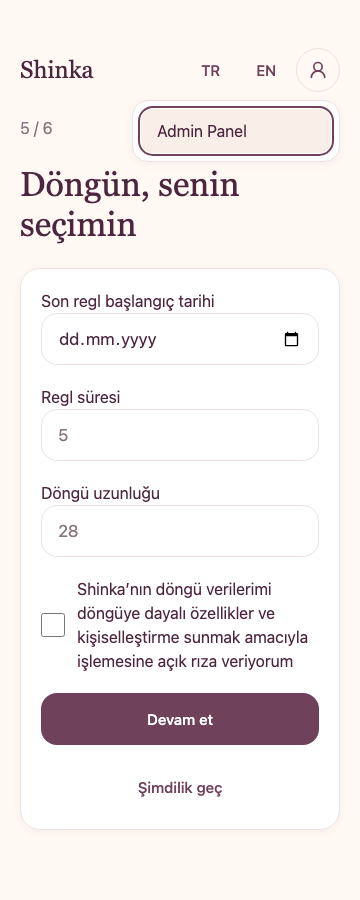
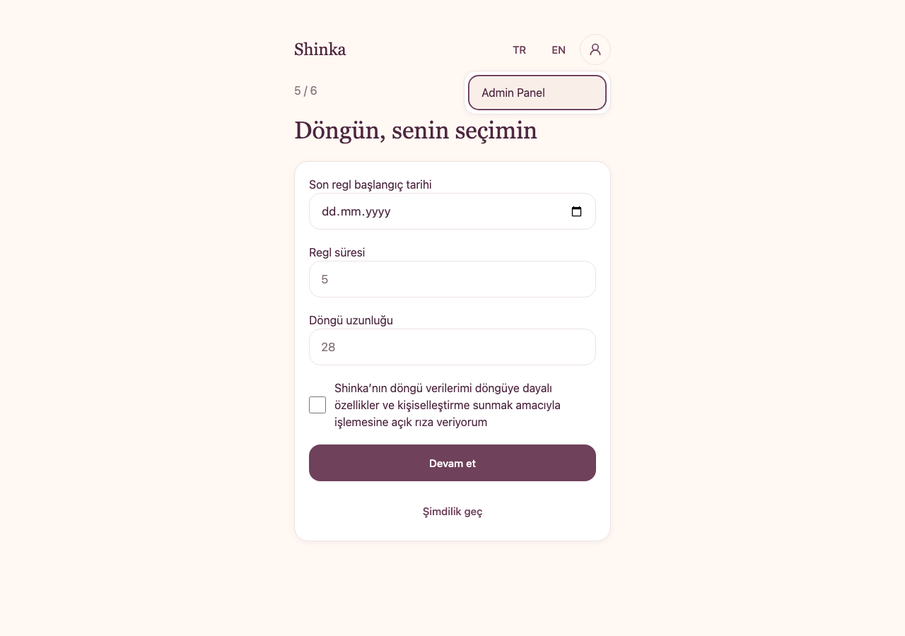
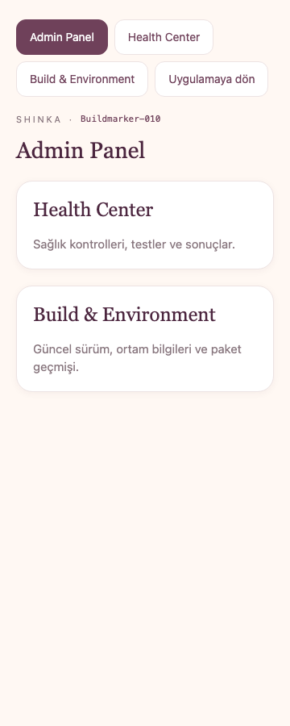
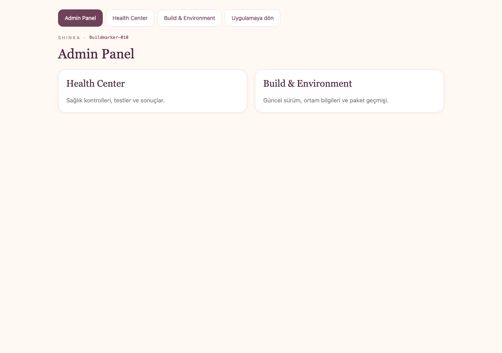
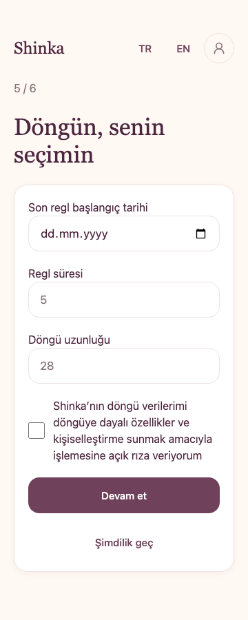
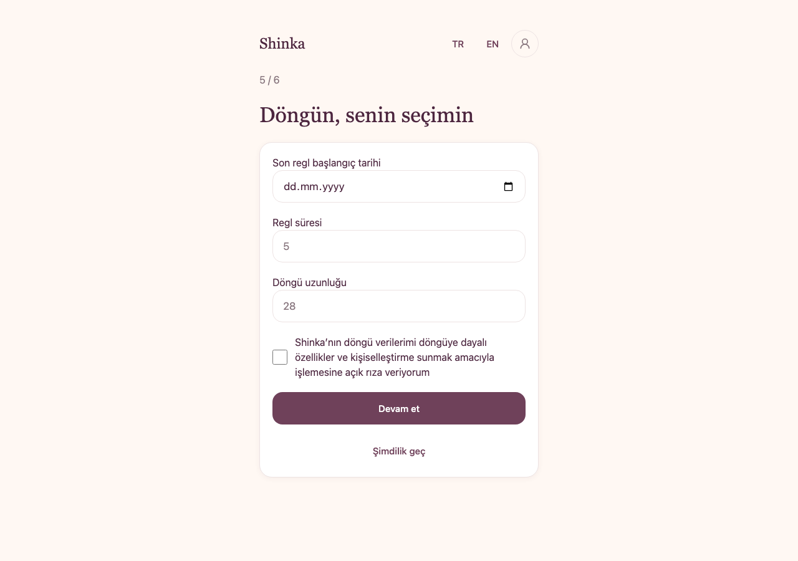

# Shinka — Admin Profile Access / Buildmarker-010

Date: 2026-10-20 (Europe/Istanbul). Catalog: HC-010.0. Evidence scope: LOCAL_BROWSER_SYNTHETIC_AND_BUILD_TIME_STATIC. No deployment, live identity verification or physical-device claim.

## Delivered behavior

Verified admin: top-right Profile/You → Admin Panel (`/internal`) → existing Health Center (`/internal/health`) / Build & Environment (`/internal/build`). Shared navigation returns to the panel and existing `/` resolver. Entry works before onboarding completion and during hydration. Ordinary users retain a disabled profile icon, not an empty profile page. The panel contains exactly two tool cards; bottom navigation is unchanged. Full You editing/preferences/account workflows remain future work.

New navigation contains no product mutation. A late onboarding hydrate response cannot start initialization after the component has unmounted; the existing first-login initialization remains in the normal onboarding coordinator. No already-issued backend operation is claimed canceled. Return hydration follows the existing durable server resolver; it does not mark onboarding complete.

AuthContext derives one frontend admin decision from the verified Base44 user. Initial or refreshing identity hides privileged access; anonymous direct routes redirect to sign-in, ordinary users receive FORBIDDEN. Internal entry, focus/visible-tab return and visible-admin polling every 60 seconds recheck identity. Same-route refresh conceals/inerts the mounted tool so an active Health run is preserved; confirmed loss removes it. Logout invalidates local identity before SDK logout and rejects late responses even if logout transport fails. Remote revocation is observed at this cadence, not through an asserted platform push guarantee. Existing server admin guards/RLS remain authoritative and unchanged.

## Implementation and contracts

| Responsibility | Files |
|---|---|
| Auth/session lifecycle | `src/lib/AuthContext.jsx`, `src/components/internal/AdminGate.jsx`; existing ProtectedRoute retained |
| Profile presentation and keyboard menu | `src/components/profile/{ProfileAccess,ProfileMenu}.jsx`; small controlled one-item menu; no added package |
| Route and panel | `src/App.jsx`, `src/pages/internal/AdminPanel.jsx`, `src/components/internal/InternalNav.jsx`, `src/foundation/internalNavigation.js` |
| Existing shells | `src/pages/{Home,Onboarding}.jsx`, `src/features/onboarding/OnboardingScreen.jsx` |
| Central copy | `src/foundation/i18n/strings.js` |
| Regression / Health | canonical `adminNavigationTests.js`, H12-025, H13-014, `scripts/checkAdminNavigation.mjs`, existing runner/test-only SDK harness |
| Package policy | Buildmarker-010 / HC-010.0, bounded generated ledger/history 006…010, explicit pre-content allowlist adds only 010; 011+ remains blocked |

UI_UX_STANDARDS, BUSINESS_FLOW, TECHNICAL_ARCHITECTURE, SECURITY_PRIVACY, CODE_STANDARDS, DEVELOPMENT_RULES, RELEASE_HEALTH_CHECK and SOURCE_OF_TRUTH are updated together. DEVELOPMENT_NOTES and generated BUILD_HISTORY record delivery; all 12 canonical marker headers are aligned. DATA_MODEL and CONTENT_MODEL receive header-only updates: no product schema/content change. No existing Health case is removed. H12-003/S08, T68/H03-009 backend denials remain. Nine external requirements, including ON-05, remain separate.

## Verification

Final results are recorded in the adjacent machine evidence. Chromium: 318/318 canonical tests, 17/17 admin scenarios, 8/8 routing/Preview, 5/5 existing mobile scenarios, 54/54 general/static Health and 21/21 onboarding Health; zero page exceptions. WebKit 27.2 passes the same 318 canonical, 17 admin, 8 routing/Preview, 5 mobile, 54 general/static Health and 21 onboarding Health checks, with zero page exceptions. See [Chromium](admin-010/chromium.json) and [WebKit](admin-010/webkit.json).

Additional required checks: clean npm ci, npm ls --all, typecheck, lint, build, Repo Health (16/16), generated history consistency, dependency audit/guard and production byte budgets. Audit reports 0 Critical / 0 High / 2 Moderate / 0 Low. The two existing React Router Moderate findings and fixed-path exposure assessment remain documented in SECURITY_PRIVACY; they are not described as patched. Standalone npm audit exits 1 for these Moderate findings; security:deps exits 0 under the required High threshold.

A dependency-based menu exceeded the initial budget; in its subsequent lazy variant, an injected aborted request in WebKit stayed in the error state after reload without a new module request. This observation did not establish a general platform/browser guarantee. The final single-link menu is small and self-contained, so that separate asset/failure path no longer exists. The development-only fault-injection scenario was retired with the deleted module, without removing any Health/security case; keyboard/Escape/arrow/Tab/focus tests remain. The Admin Panel and existing tools remain lazy; the initial production graph contains no test modules or static cycles. Final initial JS is 454,513 raw / 148,104 gzip bytes (limits 500,000 / 165,000); CSS is 85,018 / 14,572 (limits 90,000 / 16,000). [Production measurement and existing lazy-route recovery evidence](admin-010/measurements.json). Browser font requests are blocked by the local harness; screenshots show layout and configured typography, not live font delivery. WebKit is desktop automation, not proof from an iPhone.

## Screenshots

Synthetic accounts, TR, 360×900 and 1280×900 viewports. Empty cycle inputs show placeholders only; no account/health records are used.

| View | Mobile | Desktop |
|---|---|---|
| Admin Profile/You menu |  |  |
| Admin Panel |  |  |
| Ordinary user |  |  |

## Git and live handoff

Initial clean Test/local: `771db78`; main `848e073`, three commits behind. During delivery, main advanced to `3e663fe` (PR #15 merging the previous Test delivery), with an identical file tree. Local/Test were fast-forwarded and origin/Test synchronized to that commit without losing the working changes. Final feature delivery targets Test only; main is not pushed.

After the user's normal sync/publish, confirm Buildmarker-010 / HC-010.0. Use an authenticated admin with incomplete onboarding to open Profile/You → Admin Panel, visit both tools, return to the panel and app; the existing onboarding state must remain unresolved until its real business requirements are met. Test normal-user and anonymous direct visits to all three internal paths. Exercise menu keyboard/Escape and mobile widths. Remove the admin role in an authorized test session and refresh/focus the tab; confirm hidden/denied UI and independent backend denials. Run deployed Full Health and save/list/open its report. No real user role was modified by this package's tests.

ON-05 remains OPEN_PENDING_LIVE_SAVE_AND_READBACK: this navigation feature does not certify the previous consent recovery fix. Use the existing same-account live retry/readback procedure in SHINKA_ON05_CONSENT_RECOVERY.md; never reset or delete the partial account as a workaround.
