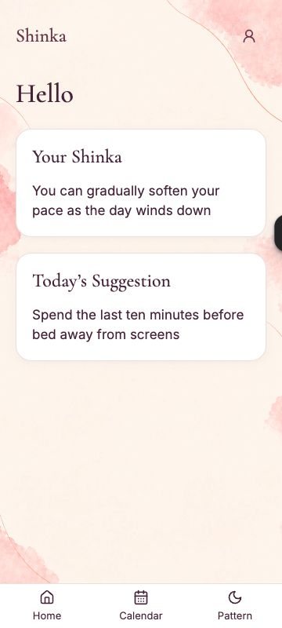

# Shinka — Core Reliability & Performance Milestone

Buildmarker-051 / HC-050.0 · 29 Ekim 2026 · Test teslimi. Main/publish yapılmadı.

**Güncel devam sonucu:** Günlük satır temizliği ve Health kayıt bakımı tamamlandı; final şema ve iki dar kod düzeltmesi Test’te hazır. Dosya silme, yayımlanmamış kodun hosted hız etkisi ve aralıklı hatanın kök nedeni açık. Kullanıcının 051/HC-050.0 **159 PASS** kabulü korunur. [Güncel sonuçlar](#051-continuation); aşağıdaki ilk teslim ölçümleri tarihsel kanıttır.

**Yerel düzeltmeler doğrulandı; hosted bakım kısmi.** 048–050, açık tema varsayılanı, doğrulanmış Profil tercihi, arka planlar, kapalı bildirim/scheduler ve ertelenmiş 12 bulgu korundu. Eski FAIL/NOT_RUN sonuçları silinmedi. Kanıtlar [051 kayıt dizininde](core-reliability-051/); aşağıdaki hosted ve yerel sonuçlar birbirinin yerine geçmez.

## Başlangıç ve yetki

- Başlangıç local/Test `6825bf3`; main `5ebc6ce`. Test, main'e çatışmasız fast-forward edildi; mevcut Base44 mobil değişiklikleri ve 049 entegrasyonu korundu.
- Gerçek uygulama `6ad5190f4845d4e3af03b420`, yayın `https://shinka-rhythm-flow.base44.app/`, gözlenen frontend **050/HC-049.0**. Git Test/Preview ayrı veri alanı değildir.
- Korunan native kimlik `6ad519134845d4e3af03b423`: güncel admin/ACTIVE doğrulandı; e-posta yalnız yetkili UI'da eşleştirildi, yetki ölçütü yapılmadı. Hesap/onam/profil sıfırlanmadı veya silinmedi. Son migration verify isteği de güncel admin/ACTIVE denetiminden geçerek 200 döndü.
- Base44 Code ekranında `internalHealth` entry'si ve mevcut native/shared bağlantıları görüldü; nativeReadiness `BASE44_NATIVE_V1 / native-continuation/2`, beş operasyonel tablo okunabilir. Tam yayımlanmış source hash eşitliği kanıtlanmadı. `hostedMutationVerified:false` başarısızlık sayılmadı.
- Başlangıçtaki kayıtlı **153 PASS / 0 FAIL / 0 BLOCKED** rapor kullanıldı; yeni canlı Full Health veya Security scan başlatılmadı. [Başlangıç](core-reliability-051/hosted-baseline.json).

## Bulgu → düzeltme → kanıt

| Bulgu ve doğrulanan neden | Düzeltme | Gerçek kanıt / sınır |
|---|---|---|
| Saklanan Pattern sekmesi geri açıldığında `onShown` yalnız boş themes değerinde yeniliyordu; gizliyken atlanan polling sonrasında eski kart kalabiliyordu | Mevcut controller ile background refresh; kartlar korunur, mevcut coalescing kullanılır | PU08 önce FAIL, sonra PASS; PF03 100 hata/toparlanma döngüsü, 10 mount, sabit istek/listener/timer sayıları. 049 canlı yüklenmeme olayının nedeni olduğu kanıtlanmadı |
| Health listesi 20 tam satırı, kullanılmayan büyük `report_json` ile taşıyordu | 11 kullanılan alana projection; tek sınırlı sorgu | HR07 + eş araçlı 10/1000 satır ölçümü; 1000 satır senaryosunda yanıt 304640 → 2290 byte. Hosted hız kazanımı değildir |
| Internal Build'de geçmiş `*_updated` kayıtları `*_changed` olarak okunup undefined görünüyordu | Bilinen iki alan adını okuyup eksik kanıta `NOT_RECORDED` göster | Canlı önceki undefined gözlemi, HR06 ve H01-006; bilinmeyen geçmiş sonuçlar true yapılmadı |
| Günlük alan temizliği aktif silmeyle birlikte tamamlanmış silmenin kalıcı işaretine de takılıyordu | Sadece COMPLETED DELETE_USER + native User yokluğu halinde dört alanın kaldırılmasına izin; bütün normal ürün yazıları tombstone korumasında | ID13: aktif iş, yeniden oluşmuş User ve normal ürün yazısı reddedilir; ID/atama/tombstone korunur. Gerçek internalHealth TS entry sınırı ayrıca test edildi. Yeni kod hosted değil |
| Son beş Health raporunu koruyan bakım yolu yoktu | Ayrı küçük `healthRetention` modülü, kapalı dispatch, tam keyset envanter, ≤25 incelenmiş ID, digest, her silme öncesi yetki/fingerprint/koruma kontrolü, bağımsız yokluk okuması | HR01–07, H17-001…004; gerçek modül izole fixture üzerinde. Hosted dryRun 400 INVALID_INTERNAL_ACTION: yayın gerekiyor |
| Kullanılmayan sidebar ve tek tüketicisi olduğu mobil hook kalmıştı | 626 + 19 satırlık iki modül ve eski Tailwind istisnası kaldırıldı | Route/import taraması ve önceki üretim bağımlılık grafiğinde yoklar; başlangıç bundle'ına hız kazancı atfedilmedi |

[İlk başarısızlıklar ve düzeltme gerekçeleri](core-reliability-051/initial-failures.json) korunmuştur. Test fixture'ındaki eski `list` beklentisi, `about:blank` üstünde test storage erişimi ve INCOMPLETE retention boşluğu da saklanmıştır; uygulama hatası gibi sunulmaz.

## Dört kritik akış

| Akış | Yerel gerçek uygulama + izole IO | Yayımlanmış 050 gözlemi |
|---|---|---|
| Onboarding | Beş adım, geri/ileri/reopen, isim/Skip, 18+, DOB-only, NULL saat/yer, saat klavye/seçici/iptal, GeoNames arama-seçim-kayıt, ayrı onam/opsiyonel döngü, kayıp yanıt/same intent ve ilk Home regresyonları PASS | Korunan hesabı resetlemedim. Yeni hesapla canlı onboarding/onam testi NOT_RUN; provider trafiği üretilmedi |
| Home | Soğuk/tekrar açılış, aynı günlük ID, güncel MessagePair, hata/Retry, gün ve hesap değişimi/late response PASS | Gerçek iki içerik kartı açıldı; üç tekrar açılışta aynı günlük ID. “Hello” hazır içerik ölçütü sayılmadı |
| Pattern | Pencere/kategori/Home tutarlılığı, bağımsız hata/Retry, güncel evre/ilk gelecek Dolunay, read-only ve dönüşte freshness PASS | İki tema bölümü ve Ay bilgisi açıldı; 360 px'de yatay taşma yok. Yeni PU08 düzeltmesinin hosted kabulü yayın sonrası |
| Calendar | Ekle/düzelt/iptal/sil/son kayıt, gelecek tarih/15 gün/>60 gün, ay/taslak/pending, kayıp ACK, aynı action ID, iki istemci ve ortak Home hesapları PASS | Takvim ve ay kontrolleri açıldı, 360 px'de yatay taşma yok. Korunan hesabın sağlık verisine test yazımı yapılmadı |

Her iki motorda TR/EN, 87 mobil layout ve 150 mobil deneyim kontrolü; sheet klavye/Escape/geri/focus, 200% metin, kaydetme/iptal/unknown ve hesap sınırları çalıştırıldı. You tema seçimi gerçek yayın UI'sında değiştirilip Escape ile iptal edildi: kayıtlı Light ve tetikleyici odak korundu; save yapılmadı. Sağlık verisi gösteren canlı Calendar ve kişisel Pattern geçmişi görüntüleri Git'e alınmadı.

Gecikmiş/hiç dönmeyen yanıt, 429/503, offline→online, çift aksiyon, bağımsız istemci, logout/hesap değişimi ve geç yanıt kapsamı tam koşuda korundu. PF03 controller/lifecycle kaynak sayımıdır; işletim sisteminin tüm promise/heap grafiğini ölçtüğü iddia edilmez. Gerçek cross-document geri/ileri denemesi iki motorda belgeyi yeniden yükledi: `pageshow.persisted=true` gözlenmedi, **BFCache restore NOT_RUN**. Sentetik pageshow/pasif focus kontrolleri ayrı PASS; fiziksel arka plan, WebView donması ve native geri kabulü açık.

## Performans

**Hosted:** [Tek cache-disabled ağ örneği](core-reliability-051/hosted-network-baseline.json): applicationSession 880 ms, onboarding 1110 ms, dailyMessage 1550 ms; DCL 2180 ms, load 2900 ms. Görülen en uzun uygulama isteği dailyMessage'dır; request ID/alt DB aşaması yakalanmadığından kesin backend kök nedeni çıkarılamaz. Yaklaşık yanıt transferleri 800/1100/1300 byte. Tüm 41 istek/11.4 MB tarayıcı eklentilerini de içerir; Shinka maliyeti diye raporlanmaz.

Home/Pattern/Calendar saklanan kartlarına üçer gerçek geçişin UI otomasyonu üst sınırları (medyan/en kötü): **108/135, 93/101, 68/170 ms**. Taze backend içerik zamanı değildir. Üç gerçek Home reload gözlemi **6802, 5171, 6852 ms**; model/tool aralarını içerir, sayfa yükleme metriği veya önce–sonra hız karşılaştırması değildir. Günlük ID üçünde de aynı. [Geçiş](core-reliability-051/hosted-retained-transitions.json), [reopen](core-reliability-051/hosted-reopen.json).

DevTools Performance kayıt girişimleri sekmeyi about:blank'a götürdü/bağlantıyı kaybetti; geçersiz kayıtlar kullanılmadı. Hosted **LCP/INP/CLS ve feedback/content/interaction süreleri NOT_RUN**. Bu açık ölçüm, 049 aralıklı olayını kapanmış saymayı engeller. 051 yayımlanmadığından hosted kod öncesi/sonrası yok; 12 satırdaki veri temizliğinin gecikmeyi azalttığı da iddia edilmez.

**Eş koşullu yerel karşılaştırma:** 050 `5ebc6ce` ve 051, aynı sentetik HTTP/veri; 5 soğuk context, 60 geçiş, 390×844, CPU 4×, API 200 ms, asset 40 ms. Aynı mevcut 76644-byte görsel/hash kullanıldı; dış fontlar iki tarafta da engelli. Tam saha testi veya HTTP-cache sıcaklık testi değildir.

| Ölçüm (ms, medyan / en kötü) | 050 | 051 |
|---|---:|---:|
| Home soğuk gerçek içerik, n=5 | 920.5 / 1108.8 | 921.4 / 1080.6 |
| Home taze sonuç yerleşimi, n=15 | 280.7 / 283.1 | 280.4 / 281.9 |
| Pattern taze sonuç yerleşimi, n=15 | 281.6 / 349.5 | 280.8 / 347.7 |
| Calendar taze sonuç yerleşimi, n=15 | 281.7 / 374.7 | 281.4 / 370.5 |
| You taze sonuç yerleşimi, n=15 | 281.9 / 342.4 | 281.0 / 331.0 |

Anlamlı ekran hız artışı kanıtlanmadı. Saklanan değer görünürlüğü yaklaşık 31 ms iken yeni yanıtın yerleşmesi yaklaşık 281 ms; ayrım ölçüm dosyalarında açık. Soğuk Home LCP medyanı iki tarafta 604 ms, CLS 0; gözlenen EventTiming maksimumu 56 → 48 ms, **saha INP/p95 değildir**. Geçiş pencerelerinde 50 ms üstü görev gözlenmedi. [Ham güvenli örnekler ve koşullar](core-reliability-051/performance-comparison.json).

**DB/SDK ölçümü:** Tek örnekli izole transport sayımı; gerçek server süresi/kredi değildir. Home ilk/yeniden 58/13 okuma, Calendar 39, Pattern themes/lunar 18/16, You 18; önce/sonra aynı. Owner/onam/lifecycle kontrolleri hız için kaldırılmadı. History listesi 10/1000 satırda bir sorgu/≤20 sonuç: yanıt **152310→1140 / 304640→2290 byte**. Domain 100/101 sınırı ve 240 mapping; ID batch/pagination testleri gizli kesilmeyi doğrular. [Önce](core-reliability-051/data-before.json), [sonra](core-reliability-051/data-after.json).

Üretim bütçeleri ve import cycle kontrolü PASS; başlangıç JS yaklaşık 475 KB / 158 KB gzip, CSS yaklaşık 79 KB / 14.5 KB gzip. Kesin son sayılar execution kaydında. Büyük Health/test chunk'ları başlangıç bağımlılıklarına taşınmadı. [Mimari envanter](core-reliability-051/architecture.json): onboarding UI 301 satır, AuthContext 180; 3549 satırlık onaylı içerik referansı uygulama karmaşıklığı sayılmadı. Genel cache/router/DB katmanı veya gereksiz dosya bölme eklenmedi. Kalan auth şablonları platform slotlarıdır; tüm repo için sıfır dead-export iddiası yok.

## Gerçek DB bakım sonucu

[26 tablo toplamı](core-reliability-051/hosted-table-counts.json): daily 18, Health 53, AdminTestOperation 7, audit 37, CalendarAction 3; içerik 6 kategori/240 eşleme/260 çift/103 mevcut Moon satırı. 103 yükleme hedefi olarak kullanılmadı. Diğer sayımlar dosyada; bunlar her ürün satırının referans denetimi anlamına gelmez.

045 akışı mevcut yetkili Test Function'dan yürütüldü: tam dryRun → yeni incelenmiş digest'ler → yedi sıralı sınırlı grup → tüm sayfalarda son verify. Busy hedefte duruldu; hedef değiştirilirken yeni plan alındı.

| | Önce | Sonra |
|---|---:|---:|
| Günlük native kayıt | 18 | 18 |
| Dört eski alanın toplam varlığı | 72 | 24 |
| Alanları doğrulanmış temiz kayıt | 0 | 12 |
| Lifecycle nedeniyle bekleyen | — | 6 |
| NotificationDelivery bağlantısı | 0 | 0 |

Bütün 18 native ID, atama digest'i ve bağlantı digest'i aynı. Son verify **200, hasMore=false, clean=false**. [Mutasyon özeti](core-reliability-051/daily-cleanup.json), [son okuma](core-reliability-051/daily-final-verify.json). Kalan beş satır üç aktif silmeye; bir satır tamamlanmış silmeye bağlı. 051 terminal-owner düzeltmesi henüz dağıtılmadı. Aktif işleri/tombstone'ları silerek bypass yapılmadı. **Dört alan opsiyonel şemada kalır; final schema/generator/inspector/D23 temizliği tamamlanmadı.**

Health Dashboard envanteri kaydırılarak **53 benzersiz run** ile tamamlandı: **50 benzersiz özel dosya referansı**, 3 eski inline rapor. Başarısız eski raporlar dahil tüm satırlar yerinde. Yeni retention endpoint'i current yayınında yok: dryRun **400 INVALID_INTERNAL_ACTION**, request ID `9435ad66-171f-4c3b-ad7e-99dc97d29a0d`, OPERATION/262 ms. **0 Health satırı / 0 dosya silindi.** [Envanter](core-reliability-051/health-hosted-inventory.json), [yanıt](core-reliability-051/retention-hosted-availability.json).

Retention son beşi canonical `completed_at` UTC/offset zamanına göre sıralar; PASS, FAIL/BLOCKED sonuçlarını seçici biçimde gizlemez. INCOMPLETE, geçersiz/eksik rapor zamanı/ID, çakışan run ID ve açık recovery ID'leri korunur. Canlı 20-satır örneğinde native `created_date` timezone'suz, completed_at açık timezone'ludur; native değere Z eklenmez ve cihaz timezone'u kullanılmaz. [Metadata kanıtı](core-reliability-051/health-native-time.json).

**Apply önkoşulu:** Health save yazıcıları durdurulup uçuşta istekler drain edilir; bütün açık/pending kurtarma run ID'leri `protected_run_ids` ile verilir. Bu koşullar doğrulanamıyorsa yalnız dryRun. `writers_drained:true` operatör beyanıdır, dağıtık kilit değildir. Her hedef öncesi tam güncel envanter, yetki ve fingerprint tekrar doğrulanır; kayıp ACK'de ayrı okuma yapılır. Kesintide aynı ID listesi için tekrar dryRun alınır; temizlenen/olmayan hedef yeni kayda dönüşmez.

Kurulu SDK'da doğrulanmış özel dosya silme yolu yok; yeni kod da dosya silmez, `NOT_SUPPORTED_BY_VERIFIED_SDK` döndürür. Retained dosya referansları korunur; özel URI/token rapora taşınmaz. Yedi operasyonun dördü aktif, ikisi kalıcı DELETE tombstone, biri completed reset; audit/receipt bağımlılıkları nedeniyle yaşları tek başına silme gerekçesi değildir. Ürün döngü geçmişi/daily atamaları/shared kaynaklar ve bu bağlı operasyonlar korunmuştur.

## Health, execution ve yayın

**6 eklenen / 5 güncellenen / 0 silinen case; 1 yeni suite.** Yeni H15-005/006, H17-001…004. Güncellenen H01-006, H05-009, H09-007, H13-017, H15-002. **185 toplam = 159 in-app + 12 yerel + 14 external**; 200-case sınırı korunur. H16, H17 dahil normal sonuçlardan sonra çalışır. Normal Health yalnız izole retention fixture'larını mutasyona uğratır.

Chromium/WebKit tam koşuları 745/745, sıfır page error; saklama/list/open/retry UI'sı doğrulandı. Yerel in-app: **146 PASS / 0 FAIL / 13 hosted-prerequisite BLOCKED**. Bu 13 sonuç yayımdaki eski içerik/readiness sorunlarını yeniden açmaz; sentetik runner canlı backend kanıtını taklit etmez. Son H17 zaman sözleşmesi dahil son kaynaklarla iki tam koşu tekrar doğrulandı. Gerçek 185 case/helper eşlemesi [case-audit](core-reliability-051/case-audit.md) ve JSON kaydındadır. npm ci/tree/audit (0 açık)/security:deps/typecheck/lint/build/repo/recordBuild ve mevcut byte/cycle kapıları çalıştırıldı. [Execution](core-reliability-051/execution.json), [Chromium](core-reliability-051/browser-chromium.json), [WebKit](core-reliability-051/browser-webkit.json).

051 tek milestone'dur; recordBuild ile aktif son beş **047–051**. Bildirim/scheduler enabled:false, fiziksel native/workflow H14-901/H16-901 ve 12 ertelenmiş güvenlik bulgusu açık.

**Senden gereken tek yayın adımı:** Test'i mevcut main → Base44 GitHub sync → publish akışınla yayınla. Özellikle internalHealth entry, tüm değişen shared modüller, Health plan/catalog ve frontend birlikte gelmeli. Şema değişikliği/push gerekmez; opsiyonel dört alanı şimdi kaldırma.

Yayın sonrasında aynı yetkiyle yapılacak bakım:
1. 051/HC-050.0 ve admin/app doğrulaması; nativeReadiness salt okunur kontrolü.
2. `internalHealth` Test Function: `{"action":"dailyReferenceMigration","request":{"action":"dryRun"}}`; yeni reviewed_digest ve ≤25 IDs ile applyBatch; aktif deletion hedeflerini bypass etmeden mevcut operation ID'leriyle tamamlanma/çatışma durumunu ayrı çöz. Her sayfada verify, aynı assignment/link digest'leri, sıfır legacy alan olmadan final şemaya geçme.
3. Health yazıcıları durdurulup recovery ID'leri belirlendikten sonra `{"action":"healthRetention","request":{"action":"dryRun","protected_run_ids":[]}}` (listeyi gerçek açık ID'lerle doldur); incelenmiş IDs/digest ve `writers_drained:true` ile applyBatch; tam verify. Boş liste otomatik varsayım değildir. Dosyalar, doğrulanmış platform silme yöntemi gelene kadar tutulur.
4. Yayın sonrası tekrar performans kaydı ve gerçek BFCache/background/Android-iOS wrapper kabulü. 049'un aralıklı canlı olayı, request-ID/alt aşama kanıtı ve gerçek ölçüm gelmeden kapatılmaz.

Resmî dayanaklar: [Playwright isolation/assertions](https://playwright.dev/docs/best-practices), [Web Vitals lab/field ayrımı](https://web.dev/articles/vitals), [BFCache persisted kontrolü](https://web.dev/articles/bfcache), [Page Lifecycle](https://developer.chrome.com/docs/web-platform/page-lifecycle-api), [OWASP iş akışı yetkisi](https://cheatsheetseries.owasp.org/cheatsheets/Business_Logic_Security_Cheat_Sheet.html), [Base44 entity API](https://docs.base44.com/developers/references/sdk/docs/type-aliases/entities), [W3C görünür odak](https://www.w3.org/WAI/WCAG22/Understanding/focus-not-obscured-minimum). Güncel doküman, kurulu SDK kabiliyeti veya fiziksel cihaz kanıtı yerine kullanılmadı.

## 051 continuation

29 Ekim 2026 · aynı Buildmarker-051 / **HC-050.1** · yeni paket yok. Başlangıç Test `ed879f1`; main `07729b5` aynı ağaca sahip PR birleşimiydi. Test kayıpsız fast-forward edildi. Mevcut görseller/manuel tema, kapalı scheduler/bildirim ve ertelenmiş 12 bulgu korunur. Main merge/publish, canlı Full Health/Security scan çalıştırılmadı.

### 1. Günlük bakım — uygulandı ve doğrulandı

Mevcut gerçek uygulama/prod `6ad5190f4845d4e3af03b420`; yayımlanmış frontend 051/HC-050.0 ve mevcut backend bakım davranışı doğrulandı. Base44 Code’daki entry/shared bağlantıları ve nativeReadiness uyumlu; tüm yayımlanmış dosyaların byte/hash eşitliği bağımsız olarak kanıtlanmadı. Git Test/Preview ayrı DB kabul edilmedi. Açık web admin oturumu kullanıldı, CLI login istenmedi.

Yeni envanter **18 satır / 12 temiz / 6 eski alanlı / 24 alan** gösterdi. Dört açık DELETE_USER operasyonu aynı operation ID ile mevcut uygulama akışından tamamlandı; toplam altı DELETE_USER terminal durumu, native User yokluğu ve silme kapsamının yokluğu doğrulandı. İlk hedef tamamlandıktan sonra kalanlar sıralı ilerledi. Operasyon/tombstone/audit/retained daily kayıtları silinmedi. Bir durum okuması `TEST_STORAGE_RATE_LIMITED` döndü; sonraki başarılı okuma ile birlikte [korundu](core-reliability-051/closure/deletions-after.json).

Üç adet ikili grup, her biri güncel dryRun → incelenen reviewed_digest → applyBatch → readback. Tam son verify: **18/18 READY, clean=true, hasMore=false, 0 eski alan, 0 bozuk/bekleyen referans**. Bütün 18 native ID, atama digest’i ve NotificationDelivery bağlantı digest’i aynı; bağlantı sayısı önce/sonra 0. [Başlangıç](core-reliability-051/closure/daily-before.json), [tam verify ve karşılaştırma](core-reliability-051/closure/daily-after.json).

Korunan sariverim native kimliği **6ad519134845d4e3af03b423**, rolü admin ve privacy revision önce/sonra aynı; son bakım çağrısı ACTIVE admission’dan geçti. Home/Pattern/Calendar normal görünümü açıldı; profil/onam/döngü resetlenmedi veya test amaçlı değiştirilmedi. [Son kimlik](core-reliability-051/closure/session-after.json).

Bu gerçek verify sonrasında final **ID_ONLY_SCHEMA**, generator, inspector ve D23 birlikte hazırlandı. Dört alan fiziksel şemadan çıkarıldı; gerekli alanlar/RLS ve yeni ID-only yazım aynı. `current` ve `final` aynı 27 şemayı üretir; emekli `daily-compat` overlay reddedilir. Statik `cleanupVerified:false / REPOSITORY_ONLY` güncel DB’yi tekrar okumadığını belirtir; canlı temizliğin kanıtı ayrı dated receipt’tir. [Tam envanter manifesti](core-reliability-051/closure/schema-stage.json), [tek gerçek şema farkı](core-reliability-051/closure/schema-stage.patch). **Canlı final şema yayınlanmadı.**

### 2. Health geçmişi — kayıtlar tamamlandı, dosyalar platform engelinde

Güncel tam envanter **54 kayıt**, son beş korunacak, 49 uygun hedef. Kullanıcı başka açık Health koşusu/save/recovery ekranı olmadığını ve bakım bitene kadar yeni yazma başlatmayacağını doğruladı; bu nedenle `protected_run_ids:[]`, `writers_drained:true` kullanıldı. Bu bir dağıtık kilit garantisi değildir. Agent hiçbir Health koşusu/save başlatmadı.

Dokuz beşli + bir dörtlü incelenmiş parti, her hedef öncesi mevcut yetki/fingerprint/koruma kontrolü ve bağımsız yokluk okuması: **49 VERIFIED_ABSENT**. Tam son verify **5 kayıt / 0 eligible / hasMore=false**, başlangıçtaki aynı son beş ID. Uygulamanın Run history ekranında beş kayıt listelendi; en yeni özel rapor açılıp native kayıtla ilişkili run `6549505b-54dd-4f38-ba6a-e8f9b2329de3`, 051/HC-050.0 ve **159 PASS / 0 FAIL/BLOCKED** doğrulandı. [Tam verify](core-reliability-051/closure/health-after.json), [UI okuma](core-reliability-051/closure/health-ui-after.json). Önceki başarısız sonuçlar sonuçlarına göre seçilmedi; en yeni beş politikası uygulandı.

Güncel resmi Data export’u **54 dolu ve benzersiz dosya referansı** gösterdi; önceki 53 kayıt/50 referans sayımı güncel kabul edilmedi, eski üç inline varsayımı kullanılmadı. 49 hedef referansı tutulan beş kayıtla paylaşılmıyor. **0 dosya silindi; 49 eski dosya hedefi bekliyor, 5 korunacak referans mevcut.** Bu bir object-store fiziksel sayımı değildir. En yeni dosyanın okunabilirliği ayrıca doğrulandı.

Web media-library’de `health-` araması sonuç vermedi. Resmi [Base44 medya belgesi](https://docs.base44.com/Building-your-app/Using-media), canlı upload’ların editor library’de olmadığını, veri satırını silmenin dosyayı silmediğini ve Customer Care’e dosya bağlantısıyla başvurulmasını belirtiyor. Belgelenmemiş endpoint denenmedi, destek mesajı gönderilmedi. Silme hedefleri satırlar kaldırılmadan önce alındı: özel, query/token içermeyen `shinka-051-health-files.local` (0600, Git dışı) 49 hedef + 5 koruma manifestidir. Git’te yalnız [referans hash’leri ve ID’ler](core-reliability-051/closure/health-files-before.json) var. Eski rapor CSV’si ve ham izler de Git dışındadır.

### 3. Gerçek performans — önce/sonra ölçüldü, kod kazancı henüz hosted değil

Gerçek yayın 051/HC-050.0, aynı admin/Chrome masaüstü/EN/Light, **544×902**, cache açık, CPU/ağ throttling yok. DevTools normal Record, gerçek reload ve tıklama olayları kullanıldı. Model/tool bekleme süreleri çıkarıldı; başlangıç/son olaylar iz saatinden alındı. Ham izler özel görüntüler nedeniyle Git’e alınmadı; hash, güvenli request ID, süre ve sayılar [performance.json](core-reliability-051/closure/performance.json) içinde. İlk after kaydında gezinme başlangıcı kaçan reload kullanılmadı; iki ek native reload ölçümü yapıldı. Reload ile iptal edilen üç eski istek başarılı süre hesabından çıkarıldı.

| Görsel hazır içerik (ms, medyan / en kötü; n) | Bakım öncesi | Bakım sonrası |
|---|---:|---:|
| Home tam açılış | 6247.6 / 6247.6; 1 | 3920.2 / 3999.9; 2 |
| İlk Pattern (iki bölüm hazır) | 2701.6 / 2701.6; 1 | 1790.4 / 1790.4; 1 |
| İlk Calendar (grid/kontroller hazır) | 7706.0 / 7706.0; 1 | 5281.8 / 5281.8; 1 |
| Home dönüşü, saklanan kartın görünmesi | 39.0 / 39.0; 1 | 38.7 / 38.7; 1 |
| Aynı Home dönüşünde taze istek tamamlanması | 1474.0 / 1474.0; 1 | 1579.6 / 1579.6; 1 |

İlk görsel geri bildirim: Home önce 465.6 ms; sonra medyan 460.0/en kötü 520.3 ms (n=2). Pattern 49.5→35.4 ms, Calendar 53.7→37.2 ms (her biri n=1). EventTiming click feedback ayrıca kaydedildi: ilk Pattern 35.546→34.097 ms, ilk Calendar 52.908→35.503 ms. Bunlar saha INP değildir. Kontroller etkin ve sonraki tıklamalar başarılıydı; tam JavaScript “etkileşime hazır” anı ayrıca instrument edilmedi (**NOT_CAPTURED**). Filmstrip sampled hazır görüntüdür.

Home başlangıç RPC dizisi (ms): önce session **833.856/665.242**, hydrate **1089.037/1240.527**, daily **3858.463/1976.943** (iki reload). Eş ek after reload’ları session **1219.174/652.735**, hydrate **1028.919/810.240**, daily **1299.856/1990.349**. Navigation→fresh response medyan/en kötü önce **5297.164/6240.442** (n=2), sonra **3914.354/3994.073** (n=2). İlk Pattern iki paralel RPC önce **2667.0/2156.3**, sonra **1745.9/1665.2**. Calendar RPC **7645.8→5208.8**. Saklanan Calendar dönüşünde yeni Calendar RPC oluşmadı; ay ve etkin kontroller korundu. Pattern dönüşü retained paint ile taze RPC’lerden ayrıdır; iki RPC’nin bitişi önce yaklaşık4170.4 ms, sonra3683.7 ms.

**En yavaş gözlenen aşama Calendar RPC.** Kodda bağımsız okumaların seri beklediği doğrulandı. Tek request içinde consent/job en çok iki, admission sonrası preferences/periods/settings en çok üç eşzamanlı okuma olacak şekilde dar düzeltme yapıldı. Yetki/ACTIVE/onam/lifecycle, owner projection, pagination, final access equality ve iki snapshot doğrulaması aynen korunur. Sorgu sayısı azalması veya snapshot transaction garantisi iddia edilmez. CA24 controlled gate + withdrawal testi geçer. **Yeni kod yayınlanmadığı için canlı önce/sonra kod hız kazancı henüz yok.** Yukarıdaki aynı-kod bakım karşılaştırması küçük örnek ve değişen server/ağ yükü içerir; görülen farkların bakım tarafından yaratıldığı kanıtlanmadı.

### 4. Aralıklı yüklenme — kısmi kanıt, kapanmadı

Sonraki Home dönüşünde **dailyMessage HTTP500**, **1503.119 ms**; platform request ID **e87ccf7f-d3b3-4995-bd51-471946431f39**, yanıt tarihi **2026-10-29 20:19:00 UTC**. Kartlar korunmuştu; izleyen daily isteği 200/~1796.5ms ile tamamlandı. İlk açılışta sonsuz yüklenme yeniden oluşmadı; kısa gerçek arka plan dönüşü ve sonraki açılışlar kullanılabilirdi.

Response body ham izde yok (resource content kapalı); sonraki reload önceki Network listesini sıfırladığı için kod/backend alt aşaması geri alınamadı. Function Logs görünümünde bu request ID’ye bağlı tanı bulunamadı. Mevcut güvenli tanı yolları korunur; artık kaydedilmiş platform ID ile destek/server korelasyonu mümkündür. **FUNCTION_RPC aşaması biliniyor; backend/DB alt aşama, kesin kök neden ve orijinal 049 olayıyla eşitlik UNKNOWN.** Tarayıcı/background throttling veya bozuk DB kök neden ilan edilmedi. Sentetik late response/error/Retry regresyonları fiziksel cihaz veya canlı olay kapanışı sayılmadı.

### 5. Yerel test ve Health

Chromium **746/746**, WebKit **746/746**, sıfır page error. Son CA24 Promise callback tip düzenlemesinden sonra Chromium yalnız CA24 tekrar PASS; WebKit tam koşusu son callback biçimini içerir. Native TS entry substitution: 10 session, 5 route, 2 artifact, 7 internalHealth ve 7 deletion kontrolleri PASS; SC01–05/07–09 sunucu fixture kontrolleri PASS. Yerel in-app Health **146 PASS / 13 hosted-prerequisite BLOCKED / 0 FAIL**, save/retry/list/private open PASS. Bunlar kabul edilmiş canlı 159 PASS sonucunu yeniden açmaz.

**0 Health eklendi / 5 güncellendi / 0 silindi**: H04-007, H08-002, H12-027, H15-005, H15-002. Aynı185 ID, HC-050.1; H14-901/H16-901 ve fiziksel/native/BFCache kabulü açık. HR07 ayrıca listede kaybolan kayıtlı katalog sürümünü doğrular; projection 11→12 alan, report_json taşınmaz. İlk CA24 fixture AUTH_REQUIRED, tip kontrolü hataları ve başarılı düzeltmeleri [execution](core-reliability-051/closure/execution.json) içinde korunur. Type/lint/build/repo/schema-stage/history, dependency tree/audit (0 açık) ve mevcut byte/cycle/route kapıları PASS. Paket bağımlılıkları değişmedi; mevcut lockfile ile npm ci ve dependency tree kapıları da yeniden tamamlandı.

### 6. Owner yayın/platform adımı ve açık işler

**Yayın adımı:** Test’teki bu 051 devamını mevcut main/GitHub sync akışınıza alın; tüm27 uzak şema envanterini karşılaştırarak yalnız UserDailyMessage’ın dört alan kaldırma farkını uygulayın → native entry/shared (özellikle calendarReader, internalHealthOperations, HC-050.1) → eşleşen frontend. Tam paket `node scripts/prepareSchemaStage.mjs /private/tmp/shinka-051-final-reviewed origin/main current` ile yeni/boş hedefe yeniden üretilebilir; manifest/hash ve diff incelenmeden eksik klasörden entities push kullanmayın. Hiçbir şema push/deploy/publish bu çalışmada yapılmadı. Yayın sonrası aynı koşullarda Calendar ölçümü, yayımlanmamış kodun gerçek hız etkisini kapatacak kalan teknik doğrulamadır; mevcut şema/generator/inspector/D23 birlikte teslim edilmiştir.

Dosyalar için ayrı platform engeli vardır: doğrulanmış SDK/web object-delete yolu yok, resmi yol Customer Care. Özel yerel manifest hazır; satırların temizliği dosyaların fiziksel silindiği anlamına gelmez. Bu engeli veya tekrarlayan 500’ün kök nedenini yayın adımıyla kapanmış göstermiyoruz. Tek bir yayın işlemi bu bağımsız platform işini tamamlayamaz. Orijinal fiziksel Android/iOS, wrapper/BFCache ve 12 ertelenmiş backend bulgusu değişmedi.

## 051 targeted Health read closure

30 Ekim 2026 · aynı Buildmarker-051 / **HC-050.2** · yalnız bildirilen iki BLOCKED ve ilişkili okuma/tanı kapsamı. Temiz Test `cc63eec`, main `d949b5b` birleşimine fast-forward edildi; mevcut 051 ve Base44 çalışmaları korundu. Yeni ürün paketi/audit veya DB bakımı yapılmadı.

### Korunan canlı kanıt ve neden sınırı

Kullanıcının yayımlanmış HC-050.1 raporu: run `3df95c72-c24a-4d18-aa36-4067758e4a1a`, **157 PASS / 0 FAIL / 2 BLOCKED**. H05-009: 6/240/260 sayımlarına rağmen exact verification HTTP429/RATE_LIMITED, LIFECYCLE_READ; request `9b688272-cd41-4202-ade3-9b1ff83ae1f0`, 2026-10-29T20:54:19–20Z. H09-004 actual boş. Eski sonuç değiştirilmedi; yeni yayın başarısı sayılmadı.

Kanıtlanan aşama: `contentLibrary` admin kabulünün `withUserLifecycle` SDK okuması içerik doğrulamasından önce başarısız. Eski LIFECYCLE_READ tek etiketi User, UserPrivacyRequest ve AdminTestOperation okumalarını ayırmıyor; hangisinin kota aldığı ve kotanın diğer oturumlardan etkilenmesi **belirsiz**. Önceki Home HTTP500 ile ortak neden kanıtı yok. Yeni canlı tanı/Full Health çalıştırılmadı.

Kaynak ve izole regresyonda doğrulanan gereksiz yoğunluk: content verify/moonDryRun aynı istek içinde iki auth + iki User/privacy/operation kabul serisi çalıştırıyordu. Şimdi her yeni istek bir tam kabulden geçer (boş operasyon fixture'ında 2→1 auth, 6→3 lifecycle okuması); salt okunur işlem yalnız o isteğin server-minted principal'ını kullanır. Doğrudan çağrı yeniden kabul edilir, sahte principal ve normal kullanıcı reddedilir; mutation kontrolleri değişmedi. Inventory probe'un 20 eşzamanlı SDK okuması, aynı 20 tablo korunarak **en çok 3** oldu. Bunlar canlı 429'un tek nedeni olarak sunulmaz.

### Düzeltme ve kapsam

- Koşu başına memoization ve başarısız Promise paylaşımı korunur. Tek paylaşılan readonly çağrı yalnız tamamlanmış 429 sonrası en çok bir retry yapar; iki attempt + bekleme mevcut 18s toplam ve case'in kalan 20s bütçesi içindedir. Kanıt üretmek için 250ms ayrılır; Retry-After saniye/GMT tarihi kısaltılmaz, en az 500ms bekleme ve ikinci okuma için en az 1s aranır. Bütçe yetmezse özgün tanı ile BLOCKED. Her case kendi retry zincirini açmaz.
- Gerçek 401/403, client hatası, bozuk yanıt, hash/ilişki/strateji uyuşmazlığı, timeout veya mutation retry edilmez. Geç sonuç başarı cache'ine dönüşmez; iptal sonrasında yeni çağrı çıkmaz. Aktarılmış SDK isteğinin uzakta iptal edildiği iddia edilmez.
- H09-004, contentLibrary ve moonReadiness için bağımsız code/HTTP/stage/duration/request ID ile sınırlı attempt/bütçe durumunu tutar; native uyuşmazlığı diğer tanıları gizlemez. Hash/ilişki veya bozuk yanıt FAIL; eksik Ay kapsaması BLOCKED. Sayımlar tek başına PASS vermez.
- Yeni lifecycle tanıları `LIFECYCLE_USER_READ`, `LIFECYCLE_PRIVACY_READ`, `LIFECYCLE_OPERATION_READ`; eski LIFECYCLE_READ hâlâ tanınır. Retry-After yalnız ayrıştırılmış transport header'ı olarak iletilir; ham exception/body/header veya kullanıcı kaydı rapora girmez.
- H13-012 localRegressionRequirements eski “invariant light” açıklaması kaldırıldı: varsayılan/onboarding açık, yalnız doğrulanmış Profil tercihi koyu, OS takibi yok; çalışan checkAppTheme/checkPreferenceSheets ve U19 eşlemeleri doğru. Tema/görsel/dil davranışı değişmedi.

Health **0 ekleme / 4 güncelleme / 0 silme**: H05-009, H09-004, H13-012 descriptor, H16-007. 185 katalog ID'si ve son beş paket 047–051 korunur. H14-901/H16-901, fiziksel/native kabul açık. Canonical Release Health/Architecture/Code Standards/Development Rules/Notes ve script üretimli ledger/history güncellendi.

### Gerçek doğrulama

İlk odaklı Chromium: **21/21 PASS** (HD01–16, RG01–03, SS10, DM23); HD17 daha sonra tam runner'a eklendi. İlk sandbox localhost engeli, test fixture tip hataları ve kullanılmayan import lint hatası gerçek ara sonuçlar olarak execution kaydında korunur. **Chromium ve WebKit: 753/753 PASS**, ardından son HTTP-status/uyuşmazlık önceliği değişikliği için her motorda **24/24 odaklı PASS**, sıfır sayfa hatası. Yerel Health her motorda **146 PASS / 0 FAIL / 13 hosted-prerequisite BLOCKED**; kaydetme/listeleme/açma geçti. Mevcut sunucu/native-entry fixture runner’ları PASS. npm ci/dependency tree/audit (0 açık)/security:deps/typecheck/lint/build/repoHealth/history/diff ve değişmeyen JS/CSS/route bütçesi kapıları PASS. Build’ın app-ID eksikliği uyarısı yerel dağıtılmayan derlemede korunur; hosted kanıt değildir. [Gerçek execution, güvenli tanılar ve ara başarısızlıklar](core-reliability-051/health-read-closure/execution.json).

Yayın: sahibi Test'i mevcut main/sync akışına alır; `contentLibrary`/`internalHealth` ve ortak native/shared dosyalar ile HC-050.2 frontend birlikte güncellenir. Şema/veri/import adımı yok. Yayın sonrası Health'i kullanıcı çalıştırır; kalıcı 429 varsa yeni alt aşama/request ID ve bütçe tanısı incelenir. Main/publish, canlı Full Health/Security scan, içerik importu, günlük/tarihsel temizlik çalıştırılmadı.
