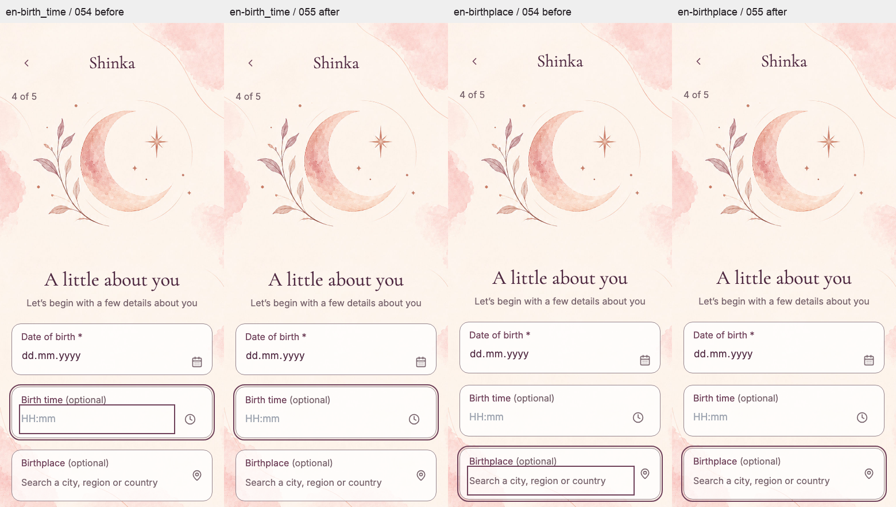
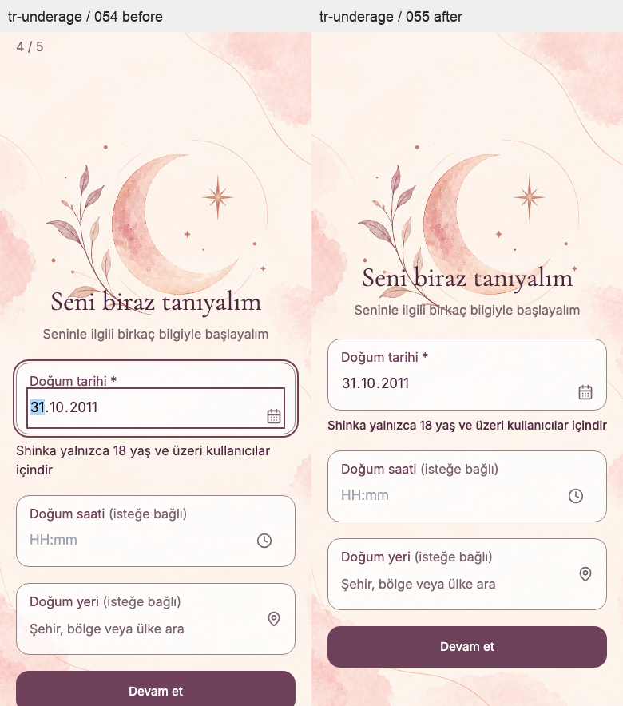
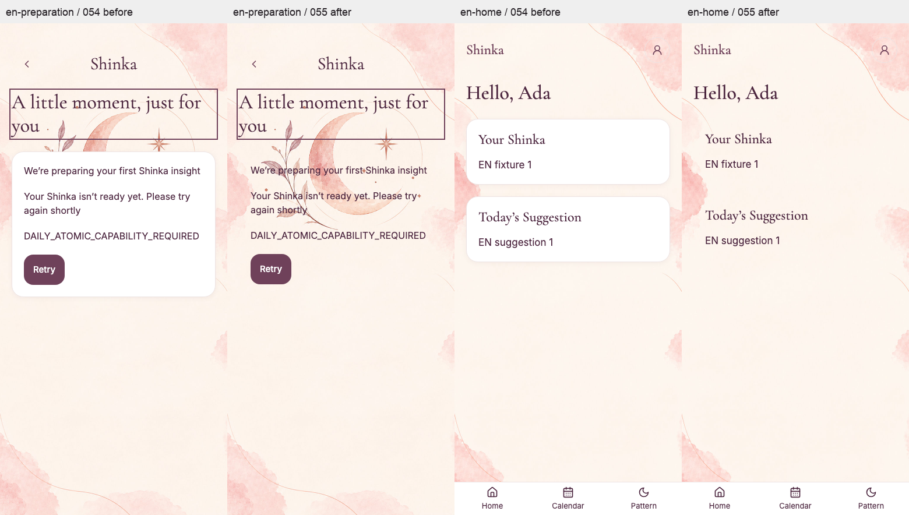

# 055 — Four onboarding corrections

Buildmarker-055 / HC-054.0. Test delivery; 052 Calendar/Pattern, 053 quota admission and 054 single background composition retained. Source baseline: `aca99eb204d498560a9e5806f88a33029f04f9f0`, initially clean main/Test/HEAD and zero divergence. This is a focused correction, not a general audit or maintenance package.

## Findings, correction and evidence

| Item | Proven finding / cause | Correction | Evidence / remaining boundary |
|---|---|---|---|
| 1. Time/place inner frame | Real-App source-054 computed styles show an inner solid focus outline and a second solid outer outline. Unlayered mobile :focus-visible overrides the Tailwind outline utility. | Only `.shinka-framed-field .shinka-framed-input` removes inner border/outline/shadow; outer focus-within remains. Shared You birthplace is checked. | U21, checkYouFlow and TR/EN browser matrix; matched before/after. HH:mm, Set/Cancel/Clear, keyboard selection and labels preserved. Physical keyboard/native picker acceptance remains open. |
| 2. Place search | Gizem10 shows retained-query failure after typing. Read-only Base44 Data shows the 053 quota schema and **zero rows**. Existing quota throws a generic onboarding error, which the adapter catches as a fetch/network error. One targeted Test Function request returned 503 / GEONAMES_NETWORK_ERROR / FETCH / UNKNOWN. | Typed missing/invalid/read/reservation diagnostics survive quota→guard→adapter→handler→service; separate central TR/EN setup copy. Existing limits, conditional reservation, refusal and explicit Retry remain. | GQ10/GQ11 and U21 distinguish setup/limit/provider, successful explicit retry/selection. **Live search is not fixed:** operator counter preparation is still required. Provider/secret/network availability and exact published backend hash remain unproven. |
| 3. Underage date | Gizem11 shows native DOB picker movement, not a product Calendar route. Source submit error focus targets the date input, which can reopen the platform picker. | Complete date feedback immediately uses shared validation and trusted server today. Partial entry is silent. Submit focuses the adjacent alert and cannot save an underage date; explicit editing and valid correction remain. | O03–O05/U20 and real-App tests: exact eighteenth birthday/day before/leap/future/invalid dates, aria relations, zero rejected save calls and zero automatic date refocus. Physical iOS picker behavior is not claimed. |
| 4. White daily surfaces | `FIRST_SHINKA_DEPENDENCY` is the unnumbered preparation interstitial; default ShinkaCard paints white/border/shadow. Home uses two such cards. | Narrow `surface="plain"` option on preparation and Home's message/suggestion/state blocks only. Default cards unchanged. | DU04, FirstShinka/ID regressions and real-App loading→not-ready→Retry→verified Home. Text order, content IDs, persistence and onReady timing unchanged. |

Attachments were examined in the requested order: time screenshot, Gizem10 video, Gizem11 video, preparation screenshot. User media and personal birth details are not copied into Git. All committed UI screenshots are synthetic.

## Read-only hosted diagnosis (2026-11-01)

Target: existing Shinka app `6ad5190f4845d4e3af03b420`, existing Base44 web session. Git Test and Preview are not separate databases. Main editor source showed both onboarding and you using the 053 shared quota guard (APP_CREDITS_V1, caps 8000/800, projected singleton lookup and conditional write; no create/upsert). Data's unfiltered GeoNamesDailyQuota inventory was empty, so this is **missing provisioning**, not evidence of an exhausted/bootstrap counter. Schema presence was directly visible. Current published Shinka Internal Build showed 054; the editor showed 054 sync and Publish menu said “Last published 2 days ago”. No publish button was executed. These observations do not prove an exact deployed backend/shared commit.

One editor Test Function `onboarding` request used a non-personal synthetic city query, action searchPlaces, language en, page 0. Result: HTTP503, error_code GEONAMES_UNAVAILABLE, diagnostic GEONAMES_NETWORK_ERROR / FETCH / UNKNOWN, upstream HTTP/provider status/class null. The old response exposed no request ID or elapsed duration; none is fabricated from tool/model waiting time. No user mutation, second probe, secret read or quota provisioning/reset occurred. Local reproduction explains this response shape when the current shared counter is absent; it does not establish the video request's exact runtime hash or prove a downstream provider outage.

055 preserves only allowlisted diagnostic code, response and upstream HTTP status, provider class/status, stage, transport class, UUID and bounded duration. Auth/lifecycle failures retain the existing sanitized health diagnostic boundary. Unknown reservation never retries automatically or reaches provider. Temporary cap/collision wait remains GEONAMES_RATE_LIMITED with Retry-After; missing/invalid setup becomes GEONAMES_QUOTA_NOT_READY. Successful search is still an external acceptance requirement; changing its message alone does not close the incident.

## Owner publication and quota preparation

1. After the dependency gate below is resolved, merge Test in the normal owner workflow; sync **onboarding + you entries and all matching shared modules, then frontend**. This package adds no entity schema. Verify the existing complete 053 schema inventory rather than pushing a partial entities directory. Publish remains owner-controlled.
2. Follow [053's counter activation runbook](SHINKA_GEONAMES_QUOTA_053.md#owner-publication--counter-activation): recheck absence/uniqueness and old-writer drain, generate a fresh payload with `node scripts/prepareGeoNamesQuota.mjs`, create exactly one APP_CREDITS_V1 row through the approved operator path and verify readback. Do not copy native IDs, create from runtime, clear usage or reset an existing row.
3. The generator conservatively reserves startup usage; honor its current window/wait (up to about 25 UTC-hour boundaries), rather than changing counters to permit traffic. After readiness, perform one explicit ≥3-character search and selected-ID resolution, verify the matching code/stage/request receipt and normal optional-clear path. Only then can live birthplace acceptance close. Hosted conditional-update atomics remain a separate 053 platform acceptance, not proven by fixtures.
4. On physical iOS/Android verify HH:mm editing and Set/Cancel/Clear, birthplace touch selection/Retry, native DOB editing after an underage alert, keyboard/reduced viewport and safe areas. Existing wrapper/back acceptance remains external. No live Full Health is run by this agent.

## Tests and Health

Detailed actual execution is in [execution.json](onboarding-fix-055/execution.json). Health: **0 added / 6 updated / 0 removed**, same 186 total (160 in-app / 12 local / 14 external). Updated H05-009, H07-001, H07-013, H10-003, H12-044, H13-012 and serialized localRegressionRequirements. New regression IDs: GQ10, GQ11, U20, U21. Existing assertion strength, optional NULL, Back/drafts, late-response/account isolation, age backend enforcement, daily ID/source/readback and quota ceilings remain.

The first full Chromium attempt retained 14 diagnostic-test failures because the old exact envelope assertions lacked the new safe metadata fields. Assertions now require the **exact expanded key set**, validated UUID/duration/response status and sensitive-data exclusion; unknown metadata is rejected, not ignored wholesale. Initial focused failures were test-fixture mistakes (You has no search action, and physical absent fields represent logical NULL); corrected tests use saveProfile's real selected-ID resolution and canonical normalization. Original failure evidence is retained alongside final results. Only log trailing whitespace is normalized for Git.

| Actual check | Result |
|---|---|
| Chromium 156.0.8078.4 / WebKit 27.2 | **775/775 PASS per engine**, zero page errors |
| New real-App corrections matrix | **8/8 PASS per engine**; TR/EN × 320/390 px × 100/200% text, reduced height, focus/Retry/Back included |
| Existing complete-page layer/You/theme/account tests | PASS in both full runners; 054 artwork/layout and manual theme retained |
| Local synthetic Health | **147 PASS / 13 expected hosted-prerequisite BLOCKED / 0 FAIL** per engine; save/retry-save/list/private-open PASS |
| Actual TS entry / SDK substitute runners | PASS, including quota entry refusal/transport, native/session, GeoNames, notifications and deletion entry contracts; no hosted atomicity claim |
| npm ci, npm ls --all, typecheck, lint, build, health:repo, generated history | **PASS** |
| Production performance/bundle gate | **PASS**; initial JS 480,996 raw / 160,140 gzip bytes; CSS 78,802 / 14,470, within existing budgets. Zero static cycles, 9 routes × 3 synthetic samples and lazy retry checked. No field speed claim. |
| npm audit / security:deps | **FAIL: 1 High, 8 Moderate, 0 Critical**; cooldown prevents current vendor patch, detailed below |

Hosted Full Health/Security scan, live counter changes, user deletion/reset and DB cleanup are **NOT_RUN by scope**. Physical iOS/Android and wrapper acceptance is NOT_RUN. Local synthetic Health evidence is never labelled live or device acceptance. Active Internal Build is generated with recordBuild and retains **051–055**. Existing non-fatal npm config and lazy-chunk/mixed-import warnings remain in the logs.

## Visual evidence

Matched before/after uses source-054 presentation files and current code with the same local synthetic transport, TR/EN, 390×844 viewport and existing public background/fonts. The old source is served by the capture harness; working files were not reverted. Current full-App checks additionally cover TR/EN × 320/390 px × 100/200% text, focus and 360px reduced height. Images are inspected for overflow, duplicate frame, readable feedback and card surface removal. Original programmatic focus on the preparation heading is outside the two-input correction and remains unchanged.

Enlarged-text/WebKit samples: [TR age feedback at 320 px / 200%](onboarding-fix-055/chromium-underage-tr-320-2.png), [EN Home at 390 px / 200%](onboarding-fix-055/chromium-home-en-390-2.png), [WebKit time focus at 320 px / 200%](onboarding-fix-055/webkit-birth_time-en-320-2.png), [WebKit setup feedback](onboarding-fix-055/webkit-place-setup-en-390-1.png), [WebKit preparation loading](onboarding-fix-055/webkit-preparing-tr-390-1.png).

## Dependency gate

Required fresh audit found **0 Critical / 1 High / 8 Moderate** affected packages on the unchanged lockfile. `security:deps` therefore fails; repository security closure is **OPEN**, regardless of passing UI regressions. This is not a hosted Security scan.

High: [GHSA-mrwp-f3q8-3g9p](https://github.com/advisories/GHSA-mrwp-f3q8-3g9p), Base44 SDK → Axios 1.20.0 → follow-redirects 1.16.1. Vendor patch is 1.16.2, published 2026-10-25T21:32:25.963Z per npm registry. The project's seven-day cooldown permits it only from **2026-11-01T21:32:25.963Z (2026-11-02 00:32:25.963 Europe/Istanbul)**. This check occurred earlier; no cooldown exception or dependency override is applied. Axios requires ^1.16.0, so downgrading to unaffected 1.15.11 would violate its supported dependency range. After eligibility: targeted `npm update follow-redirects`, inspect lock diff, then clean-install/audit/security/type/lint/build and canonical regressions before owner publication.

Moderate: [GHSA-g3hv-75wg-m249](https://github.com/advisories/GHSA-g3hv-75wg-m249), minimatch plus seven lint dependents. Local lint file-glob exposure; no runtime user glob input. Upstream >=11.0.1 is the patch; npm's suggested plugin downgrades/forced major substitution are not applied in this focused package. No Moderate finding is described as patched.

Disabled notification/scheduler, manual theme and the 12 deferred backend findings remain unchanged. No main merge or publish performed.
