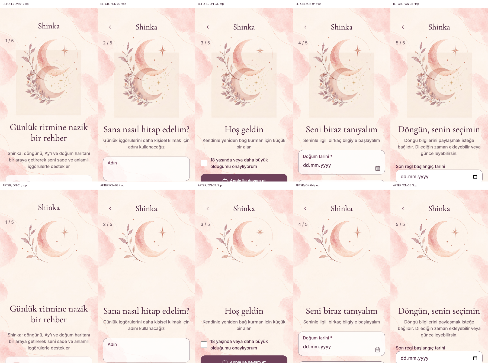

# Shinka — Onboarding single illustration, 054

Buildmarker-054 / HC-053.0 · 2026-10-30 · focused visual layering only. Preserves 051–053 stabilization, GeoNames quota, manual theme, forms, validation, name/skip behavior and pending hosted acceptance. No main merge/publish, hosted Full Health/scan, provider call, user mutation or DB maintenance.

## Evidence and correction

Initial checkout was clean: Test/local/origin Test `db04a10`; origin main `508e622` is an ancestor, with two Test-only commits. No existing change was overwritten. The supplied Android recording `Screen_Recording_20261030_142931_Shinka.mp4` was decoded locally. Frames at 22s and 24s visibly show two distinct moon/botanical arrangements moving relative to each other. The video shows only the first three steps; it supplies no ON-04/05 acceptance.

During delivery main advanced to `e86bd19` (owner's merge of 052–053). Its tree is identical to `db04a10`; Test was fast-forwarded without losing local work. The working diff SHA-256 before/after was identical, recorded in execution.json. This required no code reconciliation or repeated browser run.

The two sources were:

- `sectionBackgrounds.js` → approved `220a7ce68_Onbaording.png` CDN derivative → `SectionBackdrop::before`, fixed and non-repeating.
- `OnboardingScreen` → `airy && <IntroArt />` on **each of five numbered steps** → `4a0b6c46b_generated_image.png`, a scrolling content `` with multiply blending. Similar subject, different file/URL; counting only equal URLs would miss it.

Preserved the entire SectionBackdrop/PageContainer/background map/CSS, colors, watercolor, lines, crop/fade and theme adaptation. Removed IntroArt, INTRO_ART, its import, render, image URL and unused `.shinka-intro-art` CSS. No hidden image, new mask, z-index workaround, opacity workaround or covering layer. All three introduction-row Flower2/Moon/Sun SVG icons remain.

The replacement `.shinka-onboarding-art-space` is an empty, aria-hidden layout box: width 100%, max-width 240px, aspect-ratio 1, automatic inline margins. It paints nothing and preserves the removed image's square flow footprint and the existing sibling spacing. Only three production presentation files changed: OnboardingScreen.jsx, OnboardingIntro.jsx and onboarding.css. No business handler/service/controller changes; backend changes are only the normal Health catalog/content-policy package metadata.

## Complete-page visual verification

The browser harness mounts the real App and Onboarding page, including its real backdrop and content. Only SDK/backend transport is synthetic; the profile-to-cycle transition reuses the existing onboarding fixture/operation. External application/provider requests are blocked. Explicit screenshots load the existing public background and fonts, recording their byte hashes; ordinary offline regression blocks external assets.

Per browser: TR/EN × 320×568, 360×640, 390×844, 430×932 and 844×390 × 100%/200% text × five steps = **100 step checks** and **300 top/middle/bottom scroll views**. Forward/back preserves name/date/time drafts; focus/blur and reduced viewport exercise name/date/time fields; orientation swaps the viewport; onboarding stays light despite dark OS preference. Actual keyboard, orientation sensors, safe-area bars and native wrapper are not emulated platform proof. Existing checkAppTheme and account-switch regressions remain mandatory.

[Matched Chromium comparison](onboarding-layer-054/comparison.json): same viewports and retained background/font hashes, maximum title/card/control/layout-slot displacement **0 CSS px**, no horizontal overflow. The baseline observed two bitmaps in all five steps; after the fix exactly one remains. Every element and its before/after pseudo-elements are inspected, alongside actual screenshot review. This is not a DOM-count-only visual claim.

The five-step top/middle/bottom sheets were visually reviewed: the duplicate square image and its second moon are gone, while the fixed background and existing text/control positions remain. Retained fixed artwork can still sit behind scrolling text as before; this package does not redesign that approved background behavior. Representative before/after captures:

[Middle-scroll comparison](onboarding-layer-054/comparison-middle.png) · [Bottom-scroll comparison](onboarding-layer-054/comparison-bottom.png). Screenshot copies may be consolidated into these sheets; complete geometry and asset receipts remain in the before/after layers.json files.

## Tests and Health

- U16/U18 now require no content bitmap, a transparent empty square, unchanged numbered navigation and all three row icons. The old required `img.shinka-intro-art` assertion is replaced, not just deleted.
- T82 checks each complete OnboardingScreen together with SectionBackdrop, preserving mapping/neutral/dark assertions and rejecting an image or replacement pseudo-decoration in the spacer.
- checkOnboardingPresentation retains inner-label/name-save/focus/title tests and replaces obsolete image decode with backdrop decode. It now calls checkOnboardingLayers for the full five-step scroll/viewport matrix. No live device evidence is inferred from the local runner.
- **0 Health cases added / 3 updated / 0 removed**: H13-012 and serialized localRegressionRequirements map the new full-page evidence; H13-020 adds current-document duplicate bitmap rejection (its limited scope stays explicit); H05-009 extends unchanged strict content validation to package 054. Catalog remains 186 IDs / 160 in-app / 12 local / 14 external. Physical H13-013 and other external cases stay open. Active build history is 050–054, generated by recordBuild.

[Execution receipt](onboarding-layer-054/execution.json), actual runner logs and case-audit mappings are retained alongside the captures. Results:

| Check | Actual result |
|---|---|
| Full Chromium 156.0.8078.4 | **771/771 PASS**, zero page errors |
| Full WebKit 27.2 | **771/771 PASS**, zero page errors |
| Loaded complete-App layer matrix | **100 step checks / 300 scroll views per engine**, all PASS; name/date/time focus, reduced viewport, orientation swaps and forward/back included |
| Matched Chromium before/after | **0 CSS px** maximum title/card/control/slot displacement; retained background/font hashes equal |
| Local synthetic Health UI | **147 PASS / 0 FAIL / 13 BLOCKED** (expected hosted prerequisites); save/retry-save/list/private-open PASS in both engines |
| Clean install, dependency tree/audit, typecheck, lint, build, repo Health, last-five history | **PASS**; dependency advisories **0** at every severity |
| Production/lab performance gate | **PASS**: initial JS **476,923 raw / 158,575 gzip bytes**, CSS **78,674 / 14,456**, within 500,000/165,000 and 90,000/16,000 budgets. Zero static cycles or sample errors, lazy retry passed; 9 routes × 3 local cold samples. No field-speed or physical-device claim. |

The supplied APK defect remains historical evidence; there were no failed final assertions to discard. Existing non-fatal large-lazy-chunk/mixed-import and npm config warnings remain in logs. Only trailing whitespace is normalized for Git. Sixteen representative PNGs and the full geometry/asset receipts are committed; redundant captures are retained locally under `/private/tmp/shinka-054-all-captures` rather than duplicating every image in Git. Actual enlarged-text and landscape captures were also visually inspected. Hosted Full Health and Security scan are **NOT_RUN** by request.

## Owner / physical APK acceptance

Use the existing Test→main→Base44 sync/publish flow; this package adds no schema or data maintenance. Previous 053 counter preparation/hosted acceptance remains its separate runbook, unchanged.

On an updated physical Android APK (and separately iOS/wrapper), visit ON-01–ON-05 in TR/EN. Scroll each screen top/middle/bottom; open/close the name and birth-field keyboards, rotate, and move forward/back. Confirm one moon/botanical composition, no second copy, retained drafts, unchanged control placement and visible focus at enlarged text. Real keyboard resizing, native bars/safe-area and wrapper repaint remain **NOT_RUN** here. The old supplied APK recording is defect evidence, not post-fix device acceptance.
