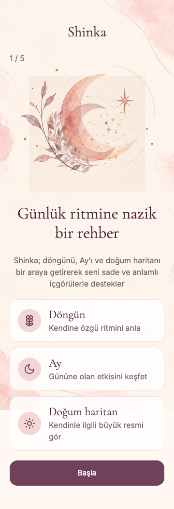
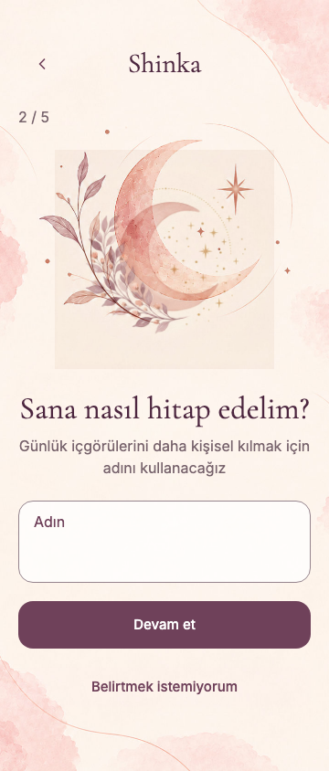
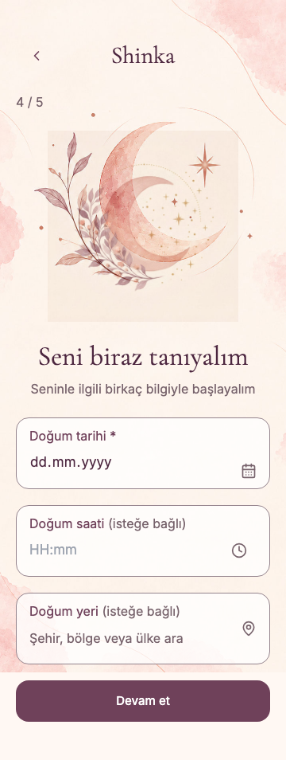

# Shinka — Focused onboarding presentation 047

Buildmarker-047 / HC-046.0. Test-only source delivery; main merge/publish and live Full Health remain owner actions. No live user/backend mutation, cleanup or import. Scope is only ON-01/ON-02/ON-04 presentation plus related verification and release metadata. Initial Test 675db64 matched remote and was one commit ahead of main c2bd53e; no incoming main change. 045 optional daily schema and all 046 section backgrounds/dependencies stay intact. Before delivery, main advanced to merge commit 83401fa, incorporating the previous 045 compatibility commit with an identical file tree. The unpublished 047 commit was rebased onto it; the tested source tree was unchanged, so adequate tests were not repeated.

## Changes and cause

1. ON-01: the apparent title frame came from unlayered `src/styles/mobile.css :focus-visible`, triggered by OnboardingScreen's `title.current.focus()` on screen changes. It overrode the utility `outline-none`. New U16/U17 assertions failed on the original code, reproducing both reported frames. A scoped h1 class, only for steps 1/4, suppresses that outline. Programmatic focus/tabIndex=-1, font, color, alignment, line layout and illustration remain.
2. ON-02: the persistent Adın/Name label now sits in the existing `.shinka-framed-field`, above a normal-flow input. htmlFor/id, given-name autocomplete, error description and value handlers are unchanged. The frame retains its border and focus-within outline; only that field's duplicate inner outline is suppressed. No disappearing placeholder or external duplicate label.
3. ON-04: the same targeted heading fix preserves its subtitle, date/time/place frames and focus indicators. No global border/outline disable or background/theme/art change.

Name ≤50 validation, blank/not-stored and Prefer not to say guard, pending-name storage, verified profile readback and forward/back progress are unchanged. U19 runs the real component and onboarding/native persistence with synthetic SDK IO to verify the saved name across Back and profile save. U02/U06/FX01/OV/OU existing behavior stays covered.

## Execution

Initial failures and the subsequent U19 fixture timing correction are retained in [initial-failures.json](onboarding-presentation-047/initial-failures.json). U19 originally clicked disabled Back before save-finally committed; it now observes enabled Back. No product timeout, validation or assertion was weakened.

The actual-App visual matrix completed **8/8 combinations per engine**: TR/EN × 360/390px × 100/200% text. Empty, filled and real keyboard-focused name geometry, accessible name/association, non-overlap, borders/focus, saved draft/Back, both unframed headings and profile field focus are measured. Existing public artwork and production fonts loaded through a narrow static-asset allowlist; all application/provider traffic is blocked and the SDK boundary is synthetic. These are desktop Chromium/WebKit results, not physical Android/iOS or hosted acceptance. [Chromium](onboarding-presentation-047/chromium-visual-matrix.json) · [WebKit](onboarding-presentation-047/webkit-visual-matrix.json).

Canonical full local regression: **Chromium 156.0.8078.4 728/728 PASS; WebKit 27.2 728/728 PASS**, identical unique ID sets, zero page errors. The final matrix also checks a long filled name at both text sizes. [Chromium execution](onboarding-presentation-047/chromium-execution.json) · [WebKit execution](onboarding-presentation-047/webkit-execution.json) · [Verification](onboarding-presentation-047/verification.json).

Local in-app Health: **140 PASS / 0 FAIL / 13 BLOCKED** per engine; save, retry-save, history listing and private report opening verified with synthetic IO. The 13 BLOCKED cases require hosted prerequisites absent in this harness (H04-019, H05-001–009, H08-005, H09-004, H12-031). They are preserved and are not new hosted failures or inferred live success. Catalog remains 179 cases (153 current in-app, 12 local acceptance, 14 external). Required native entry/server fixtures and disabled notification checks ran through the canonical runner; no live workflow/provider invocation.

Clean npm install/tree/audit (zero vulnerabilities), typecheck, lint, production build, Repo Health, generated five-package history and diff checks PASS. Existing lazy internal chunk/dynamic import warnings remain. Unchanged performance budgets PASS, zero import cycles/page errors, nine routes × three cold local samples and lazy-chunk retry. [Quality gates](onboarding-presentation-047/quality-gates.json) · [Performance receipt](onboarding-presentation-047/performance-gate.json).

## Health and documents

**0 cases added / 2 updated / 0 deleted.** Existing local H13-012 maps strengthened U16/U17, new helper U19 and checkOnboardingPresentation, which is also executed by the canonical full runner. H05-009 carries the same source verification into approved 047; HC12 keeps future packages blocked. No new Health case, fake PASS or live test. H13-013 and other external/device acceptance remain open. UI_UX ON-01/02/04 rules, Release Health and Development Notes are aligned; recordBuild generates the 043–047 active history and current canonical headers.

## Screenshots and remaining acceptance

| ON-01 | ON-02 | ON-04 |
|---|---|---|
|  |  |  |

Additional evidence: [TR 200% focused name](onboarding-presentation-047/chromium-on-02-filled-focus-tr-390-200.png), [WebKit EN 200% ON-01](onboarding-presentation-047/webkit-on-01-en-390-200.png), [ON-02](onboarding-presentation-047/webkit-on-02-en-390-200.png), [ON-04](onboarding-presentation-047/webkit-on-04-en-390-200.png), [focused name](onboarding-presentation-047/webkit-on-02-filled-focus-en-390-200.png).

NOT_RUN: physical Android/iOS keyboard, screen-reader navigation/native text settings and published application acceptance. No hosted Full Health or Security scan. Owner publishes matching GitHub/Base44 release through the existing flow; no new schema, cleanup or migration is required by this UI package. Prior 045 cleanup remains pending and separately authorized.
